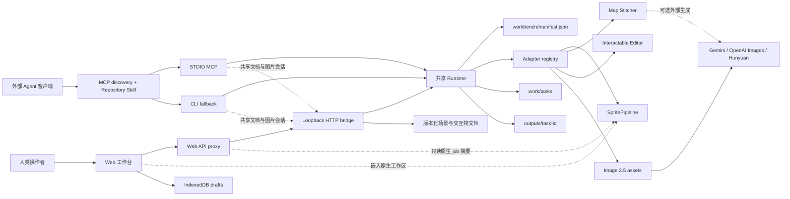

# 系统架构

规划策略 5 由 `planning_draft.py` 分离策略草案与最终执行说明，
`planning_budget.py` 为尚未执行的专家预留额度，`executable_brief.py` 验证实际
`stage.prompt`。最终说明最多 1000 字符，原有协调轮负责整理，不追加收费压缩、
截断或重试。版本随工作和作业冻结，旧编译器及旧方案保留。

可见性版本 4 由 `visibility_review.py` 核对遮挡/投影/直接矛盾证据，并保留独立
意见与最终复核的未决冲突。基础两次检查和最多五次总预算不变。主流程和选帧
修改复用接线，后者继承来源工作版本；没有新 MCP 操作或默认重绘。实际样本暴露
过最终复核误判，故这是一项不确定性保护，不能称完美几何识别。见
[视觉结构](visual-structures.md)。

选帧试做准入由 `adjustment_attempts.py` 计算逐帧已提交绘图次数，服务端在同一工作锁内检查新选择及导入备选。它与费用账本分开：理解失败记录仍可查且保留规划费用，不占未发生的绘图次数；其他范围不互相挤占，重叠帧、未知提交与旧修复保守计数。UI 不再用任务总条数禁用按钮，生成算法与冻结任务内容不变。

角色静态结构由 `collaboration/structures.py` 持久保存来源、语义请求、蒙版和纠正版本；
`structure_parser.py` 使用原图与坐标放大图提出结构，`Tools/VisualStructure/worker.py`
在独立环境中运行本地分割。只读请求不调用模型，未知提交不自动重发；手动纠正
复用未改区域并保留旧版本。静态确认本身不改变生成请求；V3 显式选择后由
`structure_control.py` 冻结到工作和方案，专家记录各段结构依据，并编入实际段级提示。
新调用前检查结构是否仍为所选版本；无选择的旧方案保留序列化与哈希。
规划格式版本 2 为策略专家单独提供 `StrategyTurn`，不混合最终计划槽位；结构视图
将可用控制标识与未知观察分开，验证端保持严格并核对关系两端。该视图版本也随
新选帧调整任务冻结；历史规划格式和调整摘要不被重写。
新任务使用版本 3，对已验证的 TokenHub Kimi K3.1 Pro 规划启用严格 JSON Schema，
并按冻结结构生成可引用标识的枚举；其他模型、历史任务和视觉复核保持原传输。
原生适配器与实际成功兼容性请求的冻结请求体一致，不代表完整动画效果已验收。
见 [角色视觉结构](visual-structures.md)。

时序观察由 `tracking.py` 绑定同一工作、候选、阶段、实际帧与原图结构；独立本地
worker 用无损 PNG 追踪部件。`tracking_observation.py` 可补充一次稀疏关键帧观察，
`tracking_data.py` 将不可信区域与关系保持未知。`temporal_review_service.py` 复用
冻结基础检查，另存结构辅助意见；`structure_judgment.py` 校验用户要求与规划建议
的来源。复核协议版本、文件哈希和实际输入一起绑定，GET、恢复和修改草稿不续费。
此观察路径仍不改变生成请求或原作品审批，不能当作已完成的姿态控制。

用户选帧修改使用独立关联任务：`adjustments.py` 冻结来源、范围、用户原话、专家建议、模型与预算；`adjustment_review.py` 复用现有检查算法，以本次用户目标评价备选；`adjustment_delivery.py` 在明确采用后更新未锁定段，或为完整候选建立衍生版本。原文件与未选中帧保持不变，原生预算和修改预算分别留存。旧修复接口不变，前端与 MCP 共用新接口。见 [选帧修改](motion-adjustments.md)。

选帧修改意图格式 v4 将明确用户要求与历史建议分开，绘图只接收简短的目标翻译与槽位约束，预留文本长度；旧协议不升级。前端默认文字修改，可选空间保护。`adjustment_import.py` 是本地维护入口，只关联已经完成且来源完全一致的隔离备选，验证图片、报告、范围和费用身份，既不调用提供方也不采用。主页面采用与工具分层，不展示无结果的选择。

区域外观修正由 `adjustment_regions.py` 验证每个真实帧上的显式二值区域，并把模型返回图与原帧合成，解码核验区域外 RGBA 相等。原始返回另存，不把合成图冒充原始模型输出。`adjustment_comparison.py` 在既有预算内分别记录目标是否实现、未要求内容是否保留，必要时复用同一次争议复核。该区域是用户授权，独立于 V1/V2 结构观察；不自动解析、追踪、推断授权或扩展边界。旧记录通过冻结协议保持原行为。

视觉可靠性已接入正式检查管线：`production_review.py` 在现有分段检查与整段检查的两次基础调用之后，运行独立外观/运动意见，并按需追加一次争议复核。`review_protocol=experts_v1` 随任务冻结；新前端任务默认启用，旧任务与旧预算请求保持兼容。全部调用使用原任务账本，局部修复历史费用不清零；翻案建议仍须实际画面裁决，不自动生成、修复或采用。离线评估工具继续隔离保存样本和标签。见 [视觉专家与争议复核](sprite-review-evaluation.md)。

开放动作 v4：全局意图与段级绘图描述分开；`motion` 保存通用外观/运动关系，短提示参与生成，完整约束参与复核。`targets.py` 在制作前绑定并冻结真实段末图，独立 `targets/` 快照不改变旧输入清单。`repairs.py` 对当前未确认片段执行有上限的局部编辑，原始目录不变，采用后以 `active_frames` 与映射表达替换并归档旧复核。窗口外帧字节不变；端点改变导致的后续依赖不得静默沿用。`motion_evidence.py` 仅提供近静止提示，不判断物理正确或自动删帧。Web 与 MCP 共用这些接口和预算。

## 1. 架构目标

Forge 是一个“外部 Agent 驱动、Web 工作台协作、能力可插拔”的本地优先项目。Codex、WorkBuddy 或其他支持 MCP 的客户端是主 Agent；Web 不提供通用 Agent 对话。角色动作模块的服务端包含受限的多专家规划器，只处理明确的动作任务与已授权调用预算。

角色动作五阶段主界面通过有路径白名单的 Web API 访问 `SpritePipeline /v1/open-motion`；MCP/CLI 的 sprite adapter 也访问同一服务。`collaboration/contracts.py` 定义版本化 TaskSpec、PlanProposal、PlanBinding 与片段回执；workspace 保存参考快照、原始需求、专家质询和历史版本；execution 复用原生 Job 的帧存储、技术 QA、人工采用和 Godot 导出。规划和生成分别持久记录调用前意图，进程锁禁止并发重发；没有远端编号的模糊结果需人工核对。仅 GET 不触发收费请求。

开放动作质量扩展使用通用合同与提示词编译，不维护动作名称分支。`quality.py` 编译事件、装备归属、结束与节奏约束，并保存移除额外上下文帧的播放映射；原始数据保持完整。`visual_review.py` 先观察全帧再验收三项合同，持久保存输入摘要与每次调用回执；中断不自动重试，帧改变后报告过期。视觉意见不自动触发再生成或采用，技术硬门禁与人工裁决仍独立存在。`model_config.py` 分离服务、可选型号与专家角色，密钥按服务保护，任务使用冻结配置。旧 v1 方案保持原哈希和执行语义；新合同不会改写独立上游固定攻击管线。

开放动作 v3 在 `collaboration/checkpoints.py` 管理实际片段证据、两步模型复核、人工裁决和锁定快照。`complete → reviewing → awaiting_review → accepted/rejected` 与原提供方提交状态分离，只有 accepted 的真实末帧可进入后段。所有视觉调用共享任务预算；进程中断不重发，阶段接受带哈希令牌并且幂等。最终组装只读取已确认快照，然后复核整段；旧方案不启用新门禁。Web 与 MCP 共用相同裁决接口。

架构需要同时保证：

- Agent 能仅通过项目指令、MCP 或 CLI 发现并调用能力。
- 人可以在统一界面查看任务、调整图形参数、预览和导出不适合纯对话完成的内容。
- 能力实现可独立演进；工作台只维护清单、协议、任务状态和适配器。
- 本地任务、输入与产物有明确边界，密钥不进入浏览器存储、任务和产物；专用服务配置可以受保护地持久保存。

## 2. 总体结构

MCP、CLI 和 Web 在允许的能力范围内汇入同一套运行时，因此不应各自实现一份能力目录或任务规则。Web 仍保留页面内编辑、浏览器草稿、嵌入式 SpritePipeline UI 和只读原生 job 摘要；这些状态必须与 runtime task 明确区分。

## 3. 分层与职责

| 层 | 主要位置 | 职责 |
| --- | --- | --- |
| 项目指令 | MCP discovery、`.agents/skills/` | 告诉外部 Agent 何时选能力、何时只准备、何时可执行 |
| 能力清单 | `workbench/manifest.json` | 定义能力 ID、输入 schema、输出、适配器、页面路由与工作流引用 |
| 接入层 | `scripts/workbench-mcp.mjs`、`scripts/workbench.mjs`、`scripts/workbench-http.mjs` | 分别提供 STDIO MCP、命令行和回环 HTTP 接口 |
| 共享运行时 | `lib/workbench/runtime.mjs` | 加载与校验清单、创建任务、调度适配器、持久化与恢复状态 |
| 能力适配器 | `lib/workbench/adapters/` | 把统一任务请求转换为工具实现或外部 API 请求 |
| Web 应用 | `app/`、`components/workbench/`、`features/` | 任务监控、参数编辑、人工交互、预览和下载 |
| 工具实现 | `Tools/` 与能力模块 | 承载具体算法或独立服务，不把算法复制进工作台壳层 |
| 数据层 | `work/`、`outputs/`、浏览器 IndexedDB | 分离任务记录、生成产物与本机浏览器草稿 |

## 4. 单一能力来源

`workbench/manifest.json` 是工作台级能力目录。以下内容必须从它读取，而不能在 MCP、CLI 或 Web 中另建常量表：

- 能力 ID、名称、状态、说明和页面路由；
- 输入 JSON Schema、必填字段和示例；
- 连接器类型、适配器名称和所需环境变量；
- 声明的产物类型；
- 工作流阶段与关联文档。

交互物项目 schema 体量较大，采用生成式同步：`features/interactable-editor/contract.mjs` 是其字段定义编辑源，`npm run schema:interactable` 将其同步到清单。同步后必须检查 manifest diff，并运行工作台 doctor 与交互物测试。

## 5. 生产能力

### Image 2.5 独立素材

`image-assets` 负责路线 A 的背景、透明物品与已有图片编辑。它嵌入地图/交互物页面，不创建重复的导航模块。统一适配器使用 `gpt-image-2.5-sunburst`，保存原始响应、规范化 PNG、尺寸、实际 Alpha 和 SHA-256。任务先持久化为 running，再异步调用；轮询不重复提交，结果不确定时需要检查。生成与采用分开：采用重读文件并核对哈希，背景成为独立地图层，透明物品绑定现有交互物。旧 PixelLab 链路继续可用；不接入 Qwen 分层。

新图片请求另保存白名单用量证据 `provider-usage.json`，包括可取得的 token 计数、HTTP/请求身份、耗时和返回质量。在图片校验前持久化，输出验证失败仍能保留已返回的 usage；缺失计数与实际账单金额保持 null。记录失败不会重新请求。费率估算属于独立评测，不能由任务 completed 推断质量通过或实际收费。

`image-assets-processing.mjs` 是新生成/编辑和本地process-image共用的确定性处理器；不联网、不缩放、不覆盖输入。蒙版Alpha=0采用候选，其余区域复制源图的解码sRGB/RGBA8，编码后再验证保护区。低Alpha清理默认仅归零prop的Alpha=1像素，且不越过蒙版保护。原始候选、派生PNG、两者哈希和processing-report分别保存；process-image在解析供应商/凭据前进入本地分支，未调用外部模型。文档和前端采用继续验证新任务身份与派生图哈希。

### 已有图片局部编辑（7A–7D）

`lib/workbench/image-edits.mjs` 将目标发现、区域解析、候选执行和定点采用连接为持久会话；五个已注册工具为 inspect、resolve、edit、apply 和 get-edit，完整名称与操作见 [图片局部编辑](image-editing.md)。本地路径对已有源图执行确定性操作，通过薄适配层复用 SpritePipeline 的纯像素核心，再使用 `process-image` 保存并验证候选；不需要 Python 服务、模型 Key 或外部图片请求。地图生产、拼接和扩展仍保持手动前端边界。

所有 `image-*` 操作从 MCP/CLI 转发 canonical Runtime Bridge，包括会刷新候选状态的读取；Bridge 不可用时失败，不回退到客户端进程写文件。同一数据目录只支持一个写入权威 Bridge。会话、命名区域、配方及 commandId 记录位于 `workspace.imageEditDirectory`；源版本、源图哈希、会话版本与目标锁共同控制写入。任务身份在适配器执行前持久化，重复命令读取原记录；崩溃后的未知提交不会自动再执行。

源 PNG/JPEG/WebP 保留原始文件字节，文件 `sha256` 与规范解码后 sRGB/RGBA8 straight-alpha 的 `rgbaSha256` 分开记录。Canvas、预览图及蒙版都不是权威像素源。7A 的 `restore-region` 在同源会话内取样恢复区域；7B 的 `candidateVersion="source"` 恢复单图为新版本，不回滚工程。宿主先完成持久保存，采用后读准确版本并更新保存基线。

7C 已接显式 `ai-edit`：增减笔刷只改硬边蒙版，`mask-runs`、基准候选、描述与参考字节在任务执行前冻结，taskId 先于模型提交持久保存。断连 / 重启只恢复原身份，不自动重发。任务保留精确会话 / 候选深链，写入 guard 不满足的历史只读。服务端把保护区基准 RGBA 本地合成并核对编码后结果；选区内画质与 Alpha 不由此保证。本批真实模型请求为 0，实际 UI 验收另记；7D 已接指定状态槽及场景引用：选中实例使用独立派生素材，其他共享实例保留；地图快照仅在验证单源像素映射后开放，图层 PNG 与嵌入源 ZIP 同一事务保存。不能确认映射的派生或合成层只读，使用源地图入口继续。像素回归和 mock 通过不代表真实模型品质或 Godot 引擎验收。

### 5.0 角色原图

`reference-art` 同时支持角色（默认 subject=character）与交互物原图（subject=prop）。物品以 kind=prop 收录，使用交互物编辑器的 artTask 精确预览入口，采用后成为具有来源 / 哈希的物件图片；不移送角色。两种用途通过 Node 适配器调用 SpritePipeline 中的窄接口，共用服务实例的受保护 PixelLab Key。Pixflux 后台任务 ID 记录在 runtime task 中；get/status 只查询原任务，完成后校验 128×128 透明 PNG 并写入任务产物。`transfer` 根据已完成源任务创建可复用角色预设，序列帧界面通过角色链接预选参考图，不生成动画。详见 [角色原图](reference-art.md)。

### 5.1 序列帧生成

`sprite-generator` 通过本地适配器连接 `Tools/SpritePipeline`。开发总控默认在回环地址启动或复用 SpritePipeline，并支持创建任务、开始生成、查询和导出。远端生成是异步的；重复查询只刷新已有上游任务，不会重新提交一次生成。

### 5.2 地图拼接

`map-stitcher` 的确定性拼接、状态恢复、区域标注与导出在本地完成。`generate-origin` 从提示词生成中心图，预览采用后再编辑；`generate-layer` 扩展已有透明模板。两者可按配置调用 Gemini、OpenAI Images 或混元 Image 3.0，外部生成不是本地拼接的前置条件。底层地图适配器不向 MCP 直接开放；场景协作可在明确地图策略、冻结服务和额度内创建／扩展候选，其他地图编辑继续使用前端。模板中 alpha 大于 0 的像素必须被保留，生成内容只填充完全透明区域。

### 5.3 独立交互物编辑

`interactable-editor` 在本地校验项目并导出 Godot 4.7.x 资源。当前支持 inspect、toggle、pickup、sequence 四类对象，以及 proximity_press、pointer_click、automatic_enter、external_request 四类触发方式。导出不要求本机安装 Godot，也不调用外部生成 API。

## 6. Agent 调用面

仓库级 STDIO MCP 暴露只读资源 `workbench://manifest`；工具名单以 manifest 的 `agentAssets.mcpServer.tools` 和实际 discovery 为准。基础任务工具为：

1. `workbench_list_capabilities`：读取当前能力目录。
2. `workbench_describe_capability`：读取目标能力 schema、连接器和输出契约。
3. `workbench_prepare_task`：仅校验并持久化任务，不运行能力。
4. `workbench_run_task`：校验后运行清单选定的本地适配器。
5. `workbench_get_task`：读取任务；对于运行中的异步任务，安全刷新同一个上游作业一次。

另有环境、服务启动、预设、模板、历史、结果、图片读取、资产、游戏交付和共享文档工具。共用 `lib/workbench/agent-api.mjs`，完整名单见 [Agent 客户端接入](agent-clients.md)。工程 Skill 是外部 Agent 文件工作流。

CLI 的 `list`、`describe`、`prepare`、`run`、`status` 与上述语义对齐。浏览器页面还可以在宿主支持 `document.modelContext` 时注册页面级工具；它们只代表当前页面的交互能力，不替代仓库 STDIO MCP。

## 7. 任务生命周期

运行时按任务建立 `work/tasks/<task-id>.json`，并为产物预留 `outputs/<task-id>/`。主要状态为：

- `prepared`：输入已校验，但尚未执行。
- `running`：适配器或已有上游异步任务仍在处理。
- `awaiting_configuration`：所需外部服务未配置；这不是完成状态。
- `attention_required`：作业已保存或需要检查/恢复，读取实际候选和下一步。
- `completed`：本次操作返回成功，声明产物已验证并记录；保存或检查完成不等于动画已导出。
- `failed`：执行失败，任务记录包含可报告的错误。

运行时只接纳位于该任务输出目录内的生成文件，防止适配器把任意本地路径伪装成产物。输入资源保持不变，新文件写入任务专属目录。

## 8. Web 工作台与本地状态

Web 工作台提供生产台、场景台、专业工具和高级配置。它负责：

- 合并展示运行时任务、SpritePipeline 原生任务与浏览器草稿；
- 在离开或替换编辑会话前保存草稿，并在繁忙或未保存时提示；
- 提供画布、图层、锚点、区域等需要直接操作的编辑器；
- 显示真实状态和产物，不伪装成内置 Agent 对话。

浏览器草稿存于 IndexedDB 数据库 `workbench-production-v1`，不等同于 `work/tasks` 中的可审计任务记录。部署后的静态或托管页面也不能自然访问开发者电脑上的 `127.0.0.1` 服务；若需要远程使用，必须单独部署经过认证与访问控制的运行时桥接。

## 9. 启动与服务拓扑

`npm run dev` 是本地完整开发入口：

- Web 应用默认监听 `http://localhost:3000`；
- 工作台 HTTP bridge 默认监听 `http://127.0.0.1:8790`；
- SpritePipeline 默认监听 `http://127.0.0.1:7860`，健康时复用，否则由总控托管；
- 当 `SPRITE_PIPELINE_API_URL` 指向非默认或非回环服务时，总控不会接管该进程。

`npm run dev:interactable` 不启动 SpritePipeline，适合只开发本地交互物编辑器。其他拆分命令见 [使用与操作手册](operations-manual.md)。

## 10. 安全边界

- API token 从服务端环境或专用配置读取。设置入口接收用户输入后不回显；不写入浏览器存储、任务 JSON、日志或提交文件。
- HTTP bridge 和默认工具服务仅监听回环地址。
- 所有本地源文件和产物路径必须解析并验证在允许的工作区或任务目录内。
- 外部调用可能产生费用或数据出站；必须先有执行授权。讨论不创建任务，明确的输入校验才使用 `prepare`。
- Web 上传由服务端接收并写入受控任务位置；当前交互物资源单文件上限 64 MB，源项目导入上限 256 MB。

## 11. 扩展原则

新增能力时，应先实现独立适配器和清单条目，再让 MCP、CLI 与 Web 自动消费。若需要外部 API，应把认证、重试、错误归一化和输出验证留在服务端适配器；浏览器只获得完成任务所需的非敏感状态。完整步骤见 [使用与操作手册](operations-manual.md)。

## 场景与交互物共享文档

场景组装在 Manifest 的 `editorModules` 注册网页入口；共享文档操作不伪装为生成任务。场景与交互物保存在 `workspace.documentDirectory`，Bridge 是写入权威，MCP/CLI 转发至同一写入入口。提交要求 `expectedRevision` 和 `commandId`，保存不可变历史与原子当前版本；恢复产生新版本。媒体嵌入并核对来源，后续修改原文件不会改变已保存快照。IndexedDB 是本地缓存与冲突恢复备份，未提交草稿不冒充服务端版本。

前端支持 `?document=<id>` 打开共享工程，干净状态跟随远端更新；忙碌、有本地修改、离线或版本冲突时保留草稿，显式加载远端前备份本地内容。AI 使用类型化命令编辑实例、排序、地图碰撞与交互物行为，不执行任意脚本。`document-observe` 对保存版本做确定性渲染，返回 PNG、内容哈希、世界坐标变换和辅助层；这不是未保存页面截图。`document-simulate` 运行既有交互模拟器的有限事件，不证明 Godot 物理或关卡可达。详见[场景组装](scene-composer.md)。

`document-export` 导出精确场景版本，复用已有导出器，将源包/Godot 包与文档哈希一同保存。输出仍进入场景导出目录并收录资产库。独立路线 A 提供背景生成、显式采用和共享场景命令；有界自动地图创建与扩展通过场景协作调度，Qwen 分层未开放。

`features/scene-composer/links.mjs` 定义稳定实例联动、类型与有向无环检查；场景模拟器按 FIFO 分发至幂等状态设置器。`simulation-replay.mjs` 为 document-simulate 和 document-observe 共用有界输入事件与最终状态计算，后者同时渲染回放后图片和有效碰撞。导出场景附带 `scene_link_router.gd`，连接已有交互运行时的信号；不创建第二套运行时。前端联动表单、状态反馈与服务器验证共用模型。实际 Godot 4.7 引擎验证另保存包哈希、物理查询与原生渲染证据。

`scene-workflows.mjs` 在同一 Bridge 中管理有界专家协作。`scene-workflow-contract/store/models/prompts/execution` 提供命令合同、快照与账本、提供方传输、角色上下文、统一执行和真实观察；`scene-workflow-generation/map` 提供新物件生成、原图创建、邻接模板扩图与确定性拼接。模型只返回提案；执行器使用候选专属文档与图片会话，复用共享保存、图片适配器、场景渲染与模拟。来源、方案、模型、额度、原请求、产物哈希和复核版本均持久化，读取任务不调度模型。地图扩展保留旧像素、世界坐标和碰撞，新增区域不自动推断碰撞。前端在采用时协调共享保存基线，避免旧草稿写回。范围与恢复见[场景专家协作](scene-collaboration.md)。

## 资产与工程交接

`asset-catalog.mjs` 按来源身份合并任务产物与原生候选，并从 manifest 的 sceneExportDirectory 收录完整场景导出；浏览器草稿不自动收录。场景保留每次导出的独立版本与两个 ZIP，不冒充生产任务。执行历史归档与资产可见性分离，资产保留创建时间和来源记录；历史搜索先过滤全量未归档记录，再按快照分页。清单描述资产，下载 ZIP 才交付文件。Sprite 导出同时提供 PNG 和单动作 Godot SpriteFrames 包，旧记录保留可选字段兼容。工程 Skill 优先消费现成包；它在授权目标项目按 CopyWorms 契约接入角色与地图，保留玩法计时、场景生命周期和第三方依赖。详见 [资产目录](asset-catalog.md) 与 [游戏工程](game-engineering.md)。

## 执行步骤到前端的确认通道

MCP 0.9.0 的 workbench_present 通过共享 runtime 写入 workspace.presentationDirectory 的短期请求，前端定期经 HTTP Bridge 回报页面身份并接收目标。页面保存草稿后在原标签切换，再确认地址到达。workbench_get_frontend_context 只读查询页面和确认；浏览器草稿仍未进入服务端资产目录。启用跟随的 MCP 连接在 run/get_task 后自动发布当前步骤；展示通道故障不改变生产任务结果。详见 [页面跟随](agent-preview-follow.md)。

## 内部素材联用

当前支持从资产库直接选择可复用源文件，及地图、交互物与场景之间的内部移送；无需下载后再上传。导入不生成、不增加后台任务，保留版本和源文件；具体入口、默认辅助显示和升级方式见 [内部素材导入](internal-imports.md)。

## Godot 游戏交付层

[Godot 交付](godot-delivery.md)在生产导出与外部 Agent 游戏工程之间建立可核对的交付记录。features/godot-export 统一包结构，lib/workbench/game-export 负责项目选择、收件、安装计划、备份与证据；网页、MCP 和 CLI 共享实现。外部 Agent 根据实际项目写接入代码；不新增通用网页 Agent 或地图生产 capability。状态与目录由 manifest.gameExport/workspace.gameExportDirectory 描述。

完整地图工程通过人工编辑器保存到 `workspace.mapProjectDirectory`，源 ZIP 位于版本化 outputs 目录，IndexedDB 保留本地备份。持久化独立于生产任务，资产库 map 类型仅索引完整工程。协议、冲突恢复和源包格式见 [地图工具](map-stitcher.md)；`npm run test:map-stitcher` 包含完整源包往返、并发版本冲突及文件完整性检查。

地图源包可带可选的 `preview.png`。Bridge 验证 PNG 像素与尺寸，作为同版本的显示附件保存；失败不阻断源包记录提交。资产预览接口校验工程版本和附件哈希，不调用合成器或图片服务。浏览器缓存只依赖地图文档中的画面数据。

### 资产回收站

`asset-trash.mjs` 在 manifest 指定的独立索引保存稳定资产 ID、别名和移入时摘要，使用跨进程目录锁与原子替换。`asset-catalog.mjs` 在扫描后合并回收站状态，默认只列 active，来源离线时仍提供可恢复的摘要。Web manage 代理和 Bridge 共享同一管理函数，不改源文件、不新建任务；MCP 查询继续只读。

### AI 局部编辑的透明度与预览

`image-edits.mjs` 将冻结的 `constraints.preserveAlpha` 传入图片适配器；开启时，`image-assets-processing.mjs` 从本次编辑基准复制 Alpha，跳过清理，并独立验证最终 PNG 的 Alpha 与蒙版外 RGBA。模型原始响应保留，不受该处理覆盖。

工作区对服务端图片编码字节及 RGBA 分别核验哈希。已保存候选和恢复图直接用于上下文预览；未保存笔划才异步编码，并以 controller、显示模式和版本限定回调有效性，不能显示旧版本结果。支持深链的宿主接收当前会话/候选通知，通过 replaceState 更新图片参数，保留宿主参数、hash 和 history.state。
